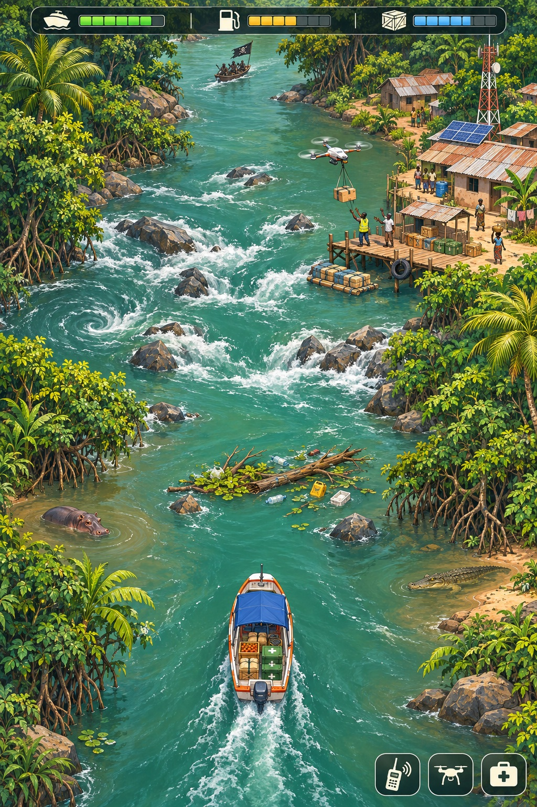

# Living River — first steps

## Goal and current state

Build a 2D top-down river adventure in Godot where steering a relief boat and delivering aid are enjoyable before adding more systems.

As of November 14, 2026, the repository contains a concept conversation and a reference image, but no Godot project. Godot `4.7.2.stable.official.ed1daf0bf` has been verified using the local console executable documented in [AGENTS.md](../AGENTS.md). This plan prepares implementation; it does not claim a playable prototype exists.

Use [conceptEn.md](conceptEn.md) as the active concept document. All new work uses English. **Living River** is the working title; title availability has not been checked.

## First playable milestone

Create one authored route taking approximately three minutes on a successful first playthrough. The player steers one boat around riverbanks and rocks, manages fuel, reaches a clearly marked village dock, and unloads one type of aid. The run ends with delivery success or a clear failure, and can immediately restart.

Provisional defaults: desktop keyboard controls, landscape 1280 × 720 viewport, strict top-down camera, northward route progression, and GDScript with the Compatibility renderer. These are implementation starting points, not decisions established by the original concept. Validate framing early: the reference is portrait, so a landscape view must still show enough river ahead to react.

Defer pirates, wildlife, drones, rafts, pollution cleanup, cargo refrigeration, upgrades, procedural generation, multiple villages, and the full 8–12-minute mission until the first run passes review.

## Quality references



The supplied image sets the direction for jade water, dense green banks, pale foam around rocks, a light-colored relief boat, river communities, and a compact resource HUD. It also depicts docks, communications equipment, solar panels, and people receiving aid. Keep these signs of contemporary community life.

Adapt its angled illustration to a readable top-down game. Do not recreate every pictured feature in the first milestone. Preserve the boat's silhouette and contrast against water, distinguish safe water from collision boundaries, and separate decoration from hazards. Original or licensed game assets will be needed; the image is not an asset sheet.

For the graybox, the quality bar is observable behavior in the checklist below. For later art work, capture gameplay at the target viewport and compare crops of the boat, banks, water, dock, and HUD with the reference. Review composition and readability before pursuing painted detail. Static art cannot establish handling quality.

## Implementation sequence

### 1. Establish a runnable baseline

- Create `project.godot`, a main scene, and only the scenes/scripts needed for the first experiment.
- Configure the engine, viewport scaling, and Input Map actions. Start with WASD/arrow steering, Space braking, E delivery interaction, and R restart; show the actual bindings in game.
- Define how boat movement, river flow, and camera progression interact. Slow or stop progression around docking so the player cannot lose a delivery merely because the camera leaves it behind.
- Add `.gitignore` entries for `.godot/`, exports, and temporary output.
- Create `doc/workbench.md` with the milestone, active task, evidence links, and review status.

Exit evidence: successful project import, headless smoke run without script errors, and a graphical launch showing the boat and river. These checks establish a baseline, not milestone acceptance.

### 2. Prove movement and navigation

- Build a short reproducible bend with banks and rocks using placeholder art.
- Add acceleration, inertia, braking, collisions, and clear damage feedback. Tune controls through play before expanding the route.
- Ensure camera lead reveals hazards before the player must react. Check that all visible passages are actually navigable.
- Keep movement and resource timing consistent across frame rates.

Exit evidence: a recording of acceleration, steering, braking, a clean passage through the bend, and a deliberate collision. Have a separate critic play or inspect motion evidence and identify the largest handling or readability problem.

### 3. Complete the delivery loop

- Add starting cargo, fuel consumption, one fuel pickup, hull condition, and a compact HUD with labels as well as color.
- Add one dock with a visible interaction zone and a clear low-speed unloading condition. The HUD explains when delivery is available and confirms completion.
- Add success after delivery, failure on depleted fuel or destroyed hull, and restart from either outcome. Prevent terminal states from overlapping or granting repeated rewards.
- Show a simple village change after success, such as an activated water pump or radio indicator, so aid has a visible result.

Exit evidence: one successful delivery recording, separate failure demonstrations, and a restart demonstrating clean reset. Use focused checks for fuel limits, delivery eligibility, terminal states, and reset where automation is practical.

### 4. Shape the three-minute route

- Extend the proven layout into an authored route with a safe opening, a winding obstacle stretch, and an approachable final dock.
- Tune length and fuel from measured playthroughs. Cargo weight is a later extension unless the simple run already passes.
- Add enough color, wake, foam, and dock cues to make navigation readable. Keep decorative foliage outside collision-critical sightlines.
- Add minimal audio cues for collision, low fuel, and delivery when assets are available; record their provenance.

Exit evidence: a full run, its measured duration, a screenshot at the intended viewport, and an independent verdict against every milestone criterion.

## Milestone acceptance checklist

Evidence status: checked items are supported by scripted simulation, graphical input playback, and independent functional/visual reviews recorded in [workbench.md](workbench.md). The route takes **169.90 simulated seconds**. Human handling enjoyment and first-play success have not been verified; the final complete-milestone approval remains open.

- [x] A clean import and launch produce no script or missing-resource errors.
- [x] The player can identify steering, braking, delivery, and restart controls without reading source code.
- [x] Acceleration, turning, and braking respond predictably; the boat can clear every intended passage.
- [x] Camera lead provides time to react, and docking remains reachable during scrolling.
- [x] Visible banks and rocks agree with their collision boundaries; impact gives clear feedback.
- [x] Fuel drains during active play, a pickup replenishes it within its maximum, and terminal screens stop simulation.
- [x] The dock communicates its interaction zone and speed requirement; aid cannot unload from elsewhere.
- [x] Delivery produces one success state and visible village feedback.
- [x] Empty fuel and destroyed hull each produce a clear failure state.
- [x] Restart restores position, velocity, camera, resources, pickups, delivery status, village feedback, and HUD.
- [x] A full successful run lasts roughly three minutes; record the measured result and explain substantial deviation.
- [x] Boat, navigable water, obstacles, dock, and HUD remain distinct at the target resolution.
- [ ] An independent critic inspected actual evidence and passed the milestone. List anything they could not verify.

## Review and iteration

Use the [Gauntlet Loop guide](https://somethingbig.ai/gauntlet-loop) as the process reference. Assign a fresh critic to each meaningful work unit. The critic inspects the actual result against its acceptance criteria, reports the largest gap, and returns it for improvement. Repeat until the criteria pass or the user stops the run.

The lead may split independent work among agents, while keeping edits to shared scenes coordinated. Critics receive references, criteria, and artifacts without the builder's reasoning. A final integration review must cover the complete run; isolated subsystem passes are insufficient.

Record each review in `doc/workbench.md` using:

```text
Objective:
Artifact or build:
Reference and acceptance criteria:
Commands/checks performed and results:
Evidence paths:
Independent critic:
Verdict: PASS / REWORK / BLOCKED
Largest remaining gap:
Next action:
Verification limitations:
```

If graphical play or independent review is unavailable, document it and leave the affected checklist items open. Never substitute a headless launch for a playable review.

## After this milestone

Choose the next feature based on playtest evidence. River currents and one clearly signaled whirlpool are natural candidates for testing whether navigation has enough depth. Expand toward two villages and an 8–12-minute mission only after movement, docking, and the complete short run pass. Revisit the visual target throughout development rather than leaving readability until final polish.

## Ready-to-use implementation task

> Build Living River's first playable milestone described in `doc/firstSteps.md`, following `AGENTS.md`. Make a roughly three-minute humanitarian delivery run whose navigation and docking feel good. Use the supplied image for visual direction and the milestone checklist for acceptance. Choose the implementation and work decomposition, use separate fresh-context critics for meaningful results, and fix the largest evidenced gap until the criteria pass or I stop the run. Keep `doc/workbench.md` updated with actual builds, review evidence, and limitations.
